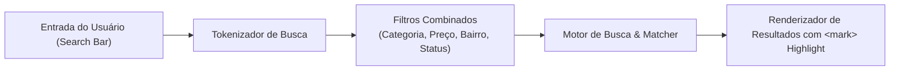
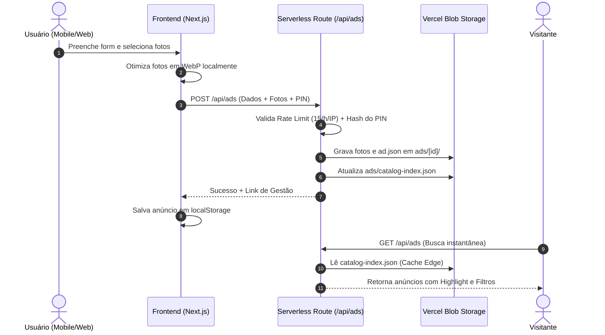

# Especificação de Design e Arquitetura KAIROS
## Plataforma de Classificados: Feira dos Amigos (Servidores de Peruíbe)

---

### 1. Visão Geral e Intenção
A **Feira dos Amigos — Servidores de Peruíbe** é um portal público, ágil e comunitário para publicação, busca, venda e troca de produtos, veículos, imóveis e serviços em Peruíbe e região. 

O foco é eliminar barreiras burocráticas: qualquer pessoa pode publicar em menos de 1 minuto diretamente do celular, sem cadastros longos ou senhas difíceis de lembrar, com contato instantâneo via WhatsApp.

---

### 2. Identidade Visual & Design System (Mobile-First)

#### 2.1 Paleta de Cores e Estética
Baseada na marca oficial (mascote alienígena feirante simpático):
* **Fundo / Canvas:** Roxo Cósmico Escuro (`#0f071b`) e Deep Violet (`#1e0e38`) para contraste premium, com modo claro limpo com toques lavanda.
* **Cor Primária (Acento):** Verde Limão / Neon Alien (`#39FF14` / `#22c55e`), usado em botões de ação (CTA), destaques e no botão direto de WhatsApp.
* **Cor Secundária:** Roxo Vibrante (`#9333ea`) e Magenta Suave (`#d946ef`) para tags, molduras e cabeçalhos.
* **Tarja "Vendido":** Carimbo estilizado vermelho/magenta com rotação de -5° e efeito carimbo com borda dupla, idêntico ao selo *"VENDAS E TROCAS"* da marca.

#### 2.2 Componentes e Padrões Mobile
* **Navegação Inferior Fixa (Mobile Bottom Bar):**
  * 🏠 **Início** (Feed de ofertas)
  * 🔍 **Buscar** (Abre busca rápida com filtros)
  * ➕ **Anunciar** (Botão central flutuante em verde neon destacado)
  * 📦 **Meus Anúncios** (Acessa os anúncios criados pelo aparelho gravados no `localStorage`)
* **Cards de Anúncios Responsivos:**
  * Carrossel de imagens com suporte a gestos de deslizar (*swipe* no celular).
  * Tag de preço com formato brasileiro (`R$ 150,00`, `A combinar` ou `Troca`).
  * Distintivo do bairro de Peruíbe e tempo da publicação (ex: *"Centro • há 2 horas"*).
  * Botão de ação rápida: *"Chamar no WhatsApp"* abrindo a conversa com texto pronto.

---

### 3. Busca Inteligente com Highlight e Filtros Avançados

#### 3.1 Mecânica de Destaque (*Highlight*)
* Quando o usuário digita (ex: *"bicicleta aro 29"*), o motor busca nos campos de título, descrição e bairro.
* Nos cards retornados, as palavras encontradas recebem um realce visual via `<mark class="bg-lime-400/25 text-lime-300 font-semibold px-0.5 rounded">`, permitindo ao usuário entender imediatamente por que aquele anúncio apareceu.

#### 3.2 Grade de Filtros
* **Campo de Busca Livre:** com botão de limpar instantâneo.
* **Chips de Categorias:**
  * 📱 Eletrônicos & Informática
  * 🚗 Veículos & Peças
  * 🏠 Imóveis & Terrenos
  * 🪑 Casa, Móveis & Decoração
  * 👕 Roupas & Acessórios
  * 🛠️ Serviços & Profissionais
  * 🍉 Produtos da Feira & Alimentos
  * 📦 Outros & Doações
* **Modalidade:** Todas, Venda, Troca, Doação/Grátis.
* **Bairros de Peruíbe:** Centro, Stella Maris, Guaraú, Três Marias, Caraguava, Jardim Ribamar, Estação, Ruínas, Arpoador, entre outros.
* **Controle de Itens Vendidos:**
  * Opção `[ ] Mostrar vendidos` (desmarcada por padrão).
  * Quando marcada, anúncios vendidos aparecem com opacidade reduzida e tarja *"VENDIDO"*.
* **Ordenação:**
  * Mais recentes
  * Menor preço
  * Maior preço
  * Próximos de expirar

---

### 4. Criação de Anúncios & Ciclo de Vida Sem Banco de Dados

#### 4.1 Formulário Descomplicado
1. **Fotos:** Upload de até 6 fotos com compressão automática em WebP no navegador (reduz arquivos pesados de câmeras de 10MB para ~200KB sem perda visível de qualidade).
2. **Dados Básicos:** Título, Descrição, Categoria, Modalidade e Preço.
3. **Localização:** Bairro de Peruíbe.
4. **Contatos:** Nome/Apelido do vendedor e WhatsApp (com máscara automática `(13) 9XXXX-XXXX`).
5. **Duração do Anúncio:** Validade selecionável (7, 15, 30 ou 60 dias). Após esse prazo, o anúncio sai da listagem ativa.
6. **PIN de Segurança:** Um código numérico simples de 4 dígitos escolhido pelo autor (ex: `1234`), que permite gerenciar o anúncio a qualquer momento.

#### 4.2 Gestão pelo Autor (*Marcar como Vendido*)
* Ao publicar, o anúncio é adicionado à aba **"Meus Anúncios"** do navegador do vendedor via `localStorage`.
* O vendedor pode a qualquer momento clicar em **"Gerenciar Anúncio"**:
  * Inserir o PIN de 4 dígitos.
  * Clicar no botão grande **"Marcar como Vendido"** (ou reativar).
  * Excluir o anúncio definitivamente.

---

### 5. Arquitetura Serverless & Vercel Blob (Zero-DB)

#### 5.1 Estrutura de Arquivos no Vercel Blob
* `ads/<ad-id>/ad.json`: Contém os dados completos do anúncio, hash do PIN, status (`ativo`, `vendido`, `expirado`), datas e URLs das fotos.
* `ads/<ad-id>/photo-<n>.webp`: Imagens servidas pela CDN global da Vercel.
* `ads/catalog-index.json`: Índice consolidado e compacto (com ID, título, preço, categoria, bairro, status, data e thumbnail) para busca instantânea em menos de 50ms sem precisar varrer múltiplos arquivos.

#### 5.2 Política de Rate Limiting & Proteção Anti-Abuso
* **Taxa Permitida:** Até **15 anúncios por hora por endereço IP**, permitindo que uma pessoa publique vários itens de uma vez sem travas.
* **Honeypot Invisível:** Campo oculto no formulário que robôs de spam preenchem automaticamente; se preenchido, o envio é descartado silenciosamente.
* **Sanitização de Dados:** Remoção de tags HTML maliciosas em títulos e descrições.

---

### 6. Plano de Execução KAIROS (Modo Gamma)

1. **Fase 1 (Estrutura & Fundação):**
   * Inicializar projeto Next.js 15 (App Router, Tailwind CSS, TypeScript, Lucide Icons).
   * Configurar tema oficial (cores cósmicas e verde-limão da Feira dos Amigos).
   * Integrar cliente `@vercel/blob` com rotas API tipadas.
2. **Fase 2 (Motor de Armazenamento & Rate Limit Serverless):**
   * Implementar rotas `/api/ads` (criação, listagem com catálogo indexado, gestão por PIN e exclusão).
   * Middleware de rate limit e sanitização de dados.
3. **Fase 3 (Busca, Highlight & Filtros):**
   * Componente de Search Bar com highlight inteligente de palavras-chave.
   * Drawer/Modal de filtros completo (bairros de Peruíbe, faixas de preço, categorias e flag de vendidos).
4. **Fase 4 (UX Mobile & Criação de Anúncios):**
   * Formulário mobile-first com compressão WebP de imagens via Canvas API.
   * Integração com WhatsApp Web/App (`wa.me` com mensagem estruturada).
   * Aba "Meus Anúncios" e painel de controle do vendedor com tarja "Vendido".
5. **Fase 5 (Testes, Auditoria KAIROS & Deploy):**
   * Testes unitários para busca, highlight, rate limit e validação de PIN.
   * Auditoria adversária KAIROS de integridade e segurança.
   * Versionamento no GitHub e configuração do Vercel Blob.
